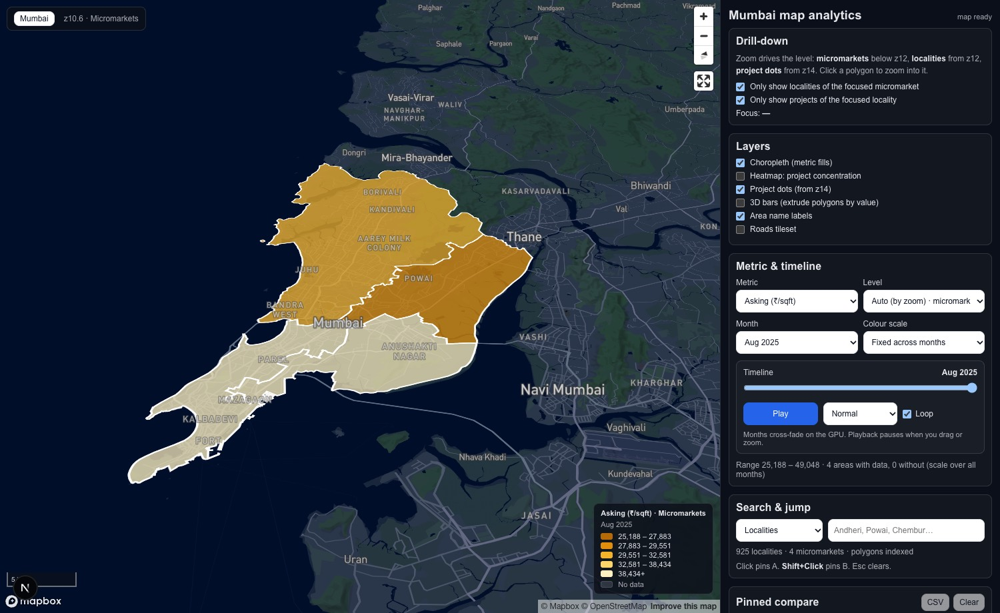
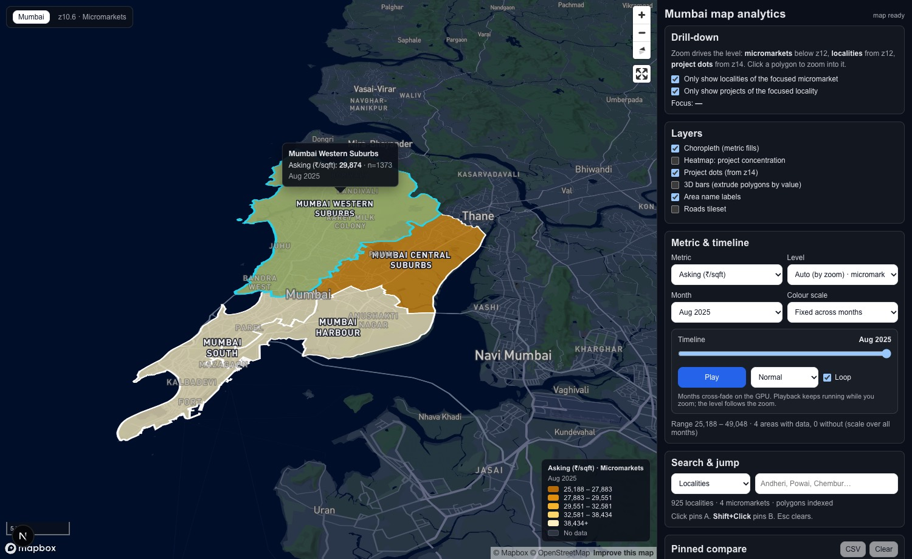
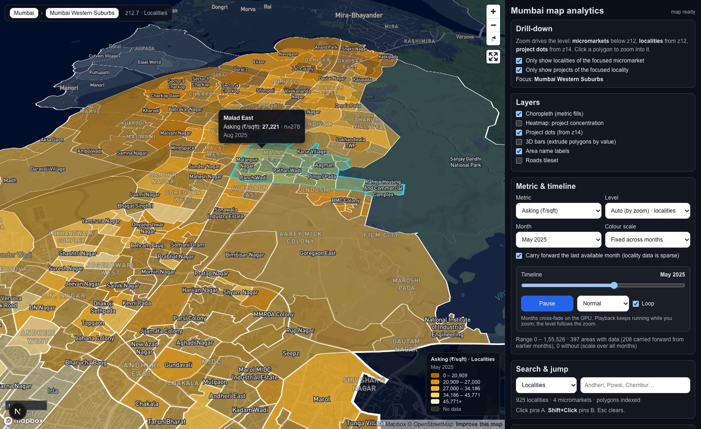
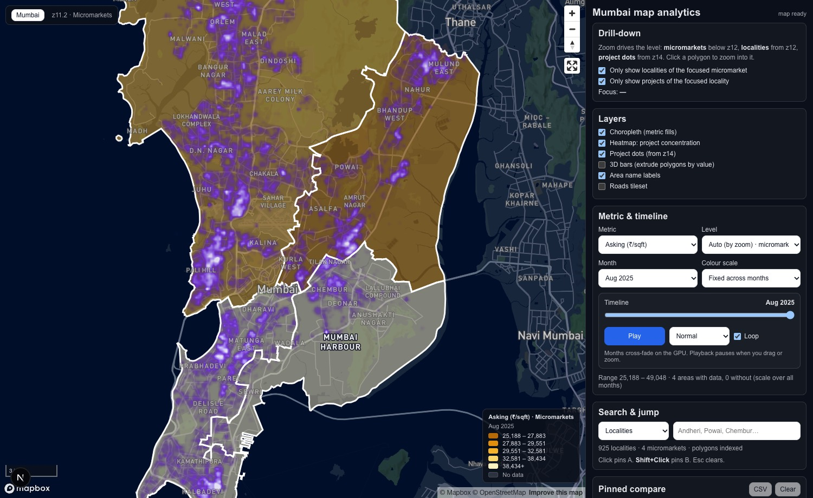
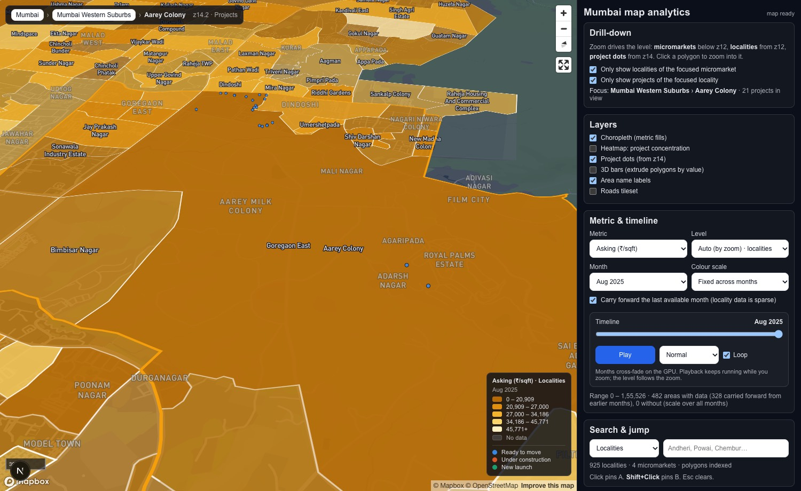
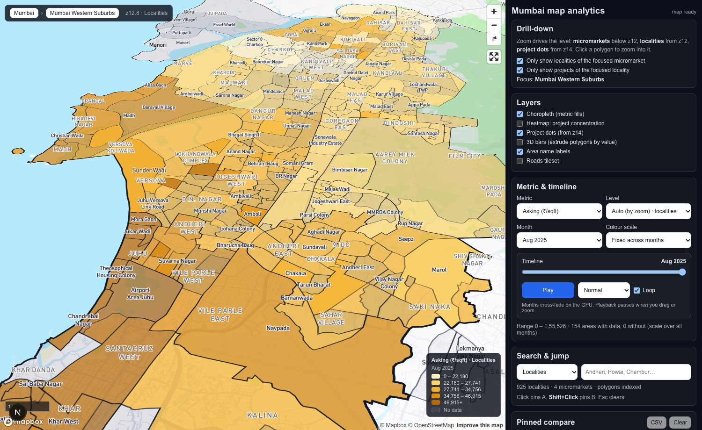

# Geo Map Analytics

Map-first real-estate analytics for Mumbai, built on Mapbox GL JS and Next.js. The map drills down with the zoom: **micromarkets** at city level, the **localities** of the micromarket you are looking at from z12, and the **projects** of the locality you are in from z14. Monthly metrics (asking price, rent) are painted as a choropleth with a smooth, GPU cross-faded timeline, project concentration can be shown as a heatmap, and any area can be pinned for an A/B comparison. Every view is a shareable URL.



---

## Screenshots

| | |
|---|---|
|  Hover highlights a micromarket; labels are placed at computed centroids. |  Inside a micromarket: only its localities are painted, timeline playing. |
|  Heatmap of ~31k project locations. |  Projects of the focused locality, coloured by status. |
|  Day light, faded theme: the palette flips so the darkest step is the highest value. | |

---

## Problem statement

Real-estate and city-intelligence teams need a fast way to:

- explore polygon layers (micromarkets, localities) and point layers (projects) without a GIS tool,
- overlay time-series metrics (asking price per sq ft, rent) on those geographies and watch them move month by month,
- compare two areas side by side,
- share the exact view with stakeholders and export it for a deck.

Dashboards are slow for spatial exploration and GIS suites are overkill for sales, ops and product workflows. This repo is the lightweight middle ground.

### Who it is for

- **Sales and pre-sales:** compare where to pitch with evidence-backed price dynamics.
- **Ops and supply teams:** track locality and micromarket movement, spot anomalies.
- **Research and analytics:** validate hypotheses visually before statistical work.
- **Product and growth:** find demand and price clusters.
- **Leadership:** a quick view plus exports for weekly reviews.

---

## What it does

### Zoom-driven drill-down
- Below **z12** the four micromarkets are painted. From **z12** the localities of the *focused* micromarket appear and the other micromarkets are dimmed. From **z14** the project dots of the *focused* locality appear.
- Focus follows where you are looking: the cursor position when the pointer is over the map (wheel zoom anchors there), otherwise the screen centre. Clicking a polygon flies into it (centred on its centroid, straight into the next band) and keeps it focused until you move the map yourself.
- Breadcrumb in the top-left (city › micromarket › locality, with the project count in view) and the drill-down panel show the current focus. The restriction toggles can be switched off to see every locality or every project at that zoom.
- Locality membership is decided **spatially** (centroid inside the micromarket polygon) with the dimension table as fallback, so a locality is never hidden because of a mismatched id.

### Choropleth and timeline
- Metrics: asking ₹/sqft, rent ₹/sqft, rent ₹/month, at micromarket or locality level (auto by zoom, or forced).
- Quantile buckets, with the colour scale **fixed across all months** by default so playback is comparable (or re-bucketed per month).
- Month changes **cross-fade on the GPU** between two fill layers instead of snapping. Playback keeps running while you pan and zoom and the level switches mid-play. Space plays and pauses.
- **Carry-forward:** locality data is sparse (roughly a quarter of localities have a value in a given month, half ever do). A month without a value is painted with the latest earlier value and the hover card says which month it came from. Switchable.
- Amber sequential ramp validated against the dark basemap; on dark light presets the brightest step is the highest value, on light presets the darkest. Emissive paint keeps colours vivid at night. A floating legend sits on the map.
- Optional 3D bars: extrude polygons by value.

### Heatmap
- Kernel-density heat of all project points (~31k), tuned so dense cores read instead of saturating; the choropleth dims while it is on.

### Count bubbles
- Project counts per **micromarket** at city zoom and per **locality** inside the focused micromarket (orange discs with the number, placed just below each area's name label). Hover shows the name and count, a click flies into that area. Bubbles dissolve as the project dots take over at z14; localities with a single project get no bubble. Counts are precomputed by `scripts/build_project_counts.mjs` from the project tiles.

### Project orbit
- Clicking a project dot centres on it and starts a slow orbit, one turn per minute, with the buildings anchored to the ground. Any wheel, drag, touch, Esc or the Stop button ends it. The 3D project renderings will use the same entry point.

### Hover, click, compare
- Hovering a polygon or project highlights it (cyan outline and tint) with a card showing the metric, count and month; the card refreshes as the timeline moves.
- Click pins **A**, Shift+Click pins **B**: current value, n, delta vs previous month, sparkline, A − B. Esc clears.
- Search any locality or micromarket by name and jump to it (pins A).

### Basemap
- Mapbox Standard with **night** light and **3D buildings** by default; dawn/day/dusk/night, default/faded/monochrome themes, place/road/POI label toggles, optional terrain.
- **Performance mode** switches off 3D buildings, landmarks and terrain for slower machines. Antialiasing is off and the canvas is not preserved between frames; PNG export reads it inside a render callback instead.

### Share and export
- The URL carries metric, level, month, light, theme, 3D, heatmap, scale, carry-forward, pins and the **camera** (`cam=lng,lat,zoom,pitch,bearing`). Only non-default values are written, and view params are versioned (`v=4`) so stale URLs cannot override new defaults.
- PNG snapshot of the map, state JSON, CSV of the pinned series, copy share URL.

### Keyboard shortcuts
`Space` play/pause · `R` reset view · `P` PNG · `J` state JSON · `C` pinned CSV · `Esc` clear pins. Shortcuts are ignored while typing in a field.

---

## Tech stack

- **Next.js 16** (App Router, Turbopack, React Compiler) · **React 19** · **TypeScript**
- **Mapbox GL JS 3.18** with the **Mapbox Standard** style (slots, light presets, 3D objects, emissive paint, feature-state, heatmap, fill-extrusion)
- **Mapbox vector tilesets** for city, micromarkets, localities, roads and projects
- Static JSON under `public/` for dimensions, metrics and project counts (no server)
- ESLint 9

---

## Repository structure

```
src/
  app/
    layout.tsx, page.tsx, globals.css      # shell, popup + control styling
  components/
    MapView.tsx                            # the app: map init, drill-down, timeline, panel, URL state
  config/
    layers.ts                              # zoom bands, source/layer ids, palettes, status colours
    metrics.ts                             # metric definitions and file paths
    tilesets.ts                            # tileset ids (from env) and source-layer names
  lib/
    mapLayers.ts                           # adds all sources/layers, preset recolouring, filters
    choropleth.ts                          # ChoroplethEngine: feature-state, two-slot cross-fade, 3D bars
    featureIndex.ts                        # polygon index: centroids, bboxes, spatial membership, labels
    carryForward.ts                        # fills sparse months with the latest earlier value
    quantiles.ts                           # quantile stops, bucket ranges, value collection
    projects.ts                            # per-project input spec (plot, towers, model, card) + loader
    export.ts, types.ts
scripts/
  build_dims_public.py                     # public/dim/*.json from data/raw
  build_metrics_v2.py                      # public/metrics/*.json from the monthly workbooks
  build_project_counts.mjs                 # public/dim/project_counts_city13.json from the project tiles
  analyze_master_plan.py                   # master plan -> towers/footprints/podium/orientation (engine + Claude)
  requirements.txt                         # python deps for the analysis script
  tileset_layers.mjs                       # prints the source-layer ids of each tileset
public/
  dim/      localities, micromarkets, project counts
  metrics/  <metric>_<level>.json
  projects/ index.json + one folder per 3D project (project.json, master plan, photos, analysis/)
docs/images/                               # screenshots used above
```

---

## Running locally

1. Install dependencies

   ```bash
   npm i
   ```

2. Create `.env.local` with a Mapbox token and the tileset ids

   ```bash
   NEXT_PUBLIC_MAPBOX_TOKEN=pk....
   NEXT_PUBLIC_TILESET_CITY=<user>.<id>
   NEXT_PUBLIC_TILESET_MICROMARKETS=<user>.<id>
   NEXT_PUBLIC_TILESET_LOCALITIES=<user>.<id>
   NEXT_PUBLIC_TILESET_ROADS=<user>.<id>
   NEXT_PUBLIC_TILESET_PROJECTS=<user>.<id>
   ```

3. Start the dev server and open http://localhost:3000

   ```bash
   npm run dev
   ```

4. Quality gates

   ```bash
   npx tsc --noEmit
   npm run lint
   npm run build
   ```

Data refresh (optional): `python scripts/build_dims_public.py`, `python scripts/build_metrics_v2.py`, `node scripts/build_project_counts.mjs`, `npm run tileset:layers`.

---

## Data model

### Tilesets (source layers and fields)

| Layer | Source layer | Fields | Notes |
|---|---|---|---|
| city | `mumbai_city` | CityName | outline only |
| micromarkets | `mumbai_micro_markets` | CityID, MicroMarketName | feature id = micromarket id (100, 102, 270, 271) |
| localities | `mumbai_localities` | CityID, LocalityName | feature id = locality id in `public/dim` |
| roads | `mumbai_roads` | CityID, RoadName | optional layer |
| projects | `mumbai_projects` | CityID, LocalityID, MicroMarketID, ProjectName, Status | ~31k points, max zoom 11 |

### Join keys
- **Micromarkets:** metric keys are the feature ids.
- **Localities:** metric keys are locality **names**. The app joins by the canonical name from `public/dim/localities_city13.json` looked up by feature id, then falls back to a normalised name match (case, whitespace, punctuation), because tile names occasionally differ from the metric keys.
- **Projects → locality:** `LocalityID` equals the locality feature id, so project filtering needs no name matching.

### Metrics document

```ts
type MetricsDoc = {
  cityId: number;
  metric: string;
  level: string;
  months: string[];                       // "2025-01-01" …
  byMonth: Record<string, Record<string, { v: number | null; n?: number | null }>>;
};
```

`carryForward()` derives a filled document where a missing month reuses the latest earlier value and tags it with `asOf`.

### Project inputs and master plan analysis

Each project that gets a 3D rendering has a folder under `public/projects/<slug>/` (listed in `public/projects/index.json`) with `project.json`, the developer master plan, exterior photos and, when available, a GLB model. The template fields are documented in the folder's README (first project: `godrej-horizon-wadala`).

`scripts/analyze_master_plan.py` reads the master plan **with code**, reusing the Green Open Area Intelligence engine (image preprocessing, plan/legend crops, OpenCV built-structure mask, JSON-only vision prompting) and adding a building-layout step: tower count and per-tower footprints, podium, north-arrow angle and road frontage. Footprints are georeferenced onto the plot polygon and written back into `project.json` (`towers[]`, `layout`, `masterPlan.analysis`). The vision step uses the Claude API (`ANTHROPIC_API_KEY` in `.env.local`) and falls back to the engine's Gemini key, then to OpenCV only.

```bash
python3 -m venv .venv && .venv/bin/pip install -r scripts/requirements.txt
GOA_ENGINE_DIR=~/green-open-area-intelligence \
  .venv/bin/python scripts/analyze_master_plan.py public/projects/godrej-horizon-wadala --overwrite
```

Outputs land in `public/projects/<slug>/analysis/` (JSON is committed, derived images are not).

### Zoom bands (`src/config/layers.ts`)

| Constant | Value | Meaning |
|---|---|---|
| `Z_LOC` | 12 | localities (and locality choropleth) from here |
| `Z_PROJ` | 14 | project dots from here |
| `Z_FADE` | 0.6 | width of the opacity fade around each threshold |

---

## Implementation notes and problems solved

- **Two-slot cross-fade.** Feature-state changes cannot be transitioned, so each level has two fill layers (`a`, `b`). A month change writes the new values into the hidden slot's state key and animates `fill-opacity` on both; the GPU does the blend.
- **Hidden layers never get paint changes.** Mapbox does not recalculate layers with `visibility: none`, so a paint change on one leaves a transition pending forever; the map then repaints continuously and never fires `idle`. Preset recolouring and the 3D-bar paint are applied only to visible layers.
- **Style reloads.** Changing a Standard-style config (theme, light) can reload the basemap. A `style.load` / `styledata` watcher re-adds missing layers and bumps an epoch so every map effect re-applies itself.
- **Labels without duplicates.** Polygon labels on vector tiles repeat per tile. The app merges tile pieces per feature id (area-weighted centroids) into a GeoJSON label source; the same index drives search, click-to-zoom extents and spatial micromarket membership.
- **Focus from the cursor.** Wheel zoom anchors at the cursor, so the micromarket under the cursor is focused, not the one under the screen centre; a click-set focus is sticky until the user moves the map.
- **Standard style slots and emissive paint.** Data layers sit in the `middle` and `top` slots so basemap labels stay readable and 3D buildings rise through the choropleth; emissive strength keeps colours vivid under the night light.
- **Join robustness.** Canonical names by feature id, normalised fallback, spatial membership and carry-forward together lifted locality coverage in a micromarket from ~16% to ~58% of polygons.
- **Dev tooling.** Turbopack is pinned to the project root (`turbopack.root`) because a stray lockfile in the home directory made it pick the wrong root and serve stale chunks.

### Verification approach

Headless Chrome is driven over the DevTools protocol (no extra packages): the driver waits for the map, moves the camera, dispatches real mouse, wheel and key events, captures screenshots and reads per-layer render counts, feature-state and Mapbox internals. The map instance is exposed as `window.__gmMap` and a debug object as `window.__gmDebug` for this purpose.

---

## Version history

- **V1** basemap and layers, hover/click inspector.
- **V2** inspect target, layer toggles, reset view, 3D toggle.
- **V2.3** dynamic choropleth, quantile legend, pins A/B with deltas and sparklines, URL state.
- **V3.1** PNG snapshot, CSV of pinned series, copy share URL.
- **V4** zoom-driven drill-down (micromarkets → localities → projects), project heatmap, night + 3D default, GPU cross-faded timeline with a fixed scale, validated amber palette with emissive paint, computed labels, panel fixes (shortcuts while typing, stale exports, search), performance (no endless repaint), camera in the share URL, modular layer/engine/index code.
- **V4.1** night default survives stale URLs, playback follows zoom, spatial membership, canonical-name joins, carry-forward, cyan hover highlight that survives camera moves, click-to-zoom into the next band with sticky focus, cursor-based focus, per-locality project counts script.
- **V4.2** project count bubbles per micromarket and locality with click-to-zoom, slow orbit around a clicked project, performance mode, lighter rendering (no antialiasing, no preserved drawing buffer, PNG export via render callback), per-project input folders, and `scripts/analyze_master_plan.py` which reads a developer master plan with the Green Open Area Intelligence engine plus the Claude API and writes towers, footprints, podium and orientation into `project.json`. First project folder: Godrej Horizon Wadala.

---

## Roadmap

- 3D project renderings on their plots: a GLB model per project where the developer supplies one, otherwise a procedural model built from the analysed towers and the facade colours; placed on the plot, visible from project zoom, capped to what is in view.
- Project card on clicking a rendering: image, price range or ₹/sqft, configurations, locality, RERA.
- Mobile tuning after the 3D work.
- Multi-city support: city switcher, per-city tilesets, dims and metrics.
- Export polish: legend and title overlay on PNG, richer CSV.

---

## License

MIT © 2026 Deepesh Gupta. See [LICENSE](LICENSE).
